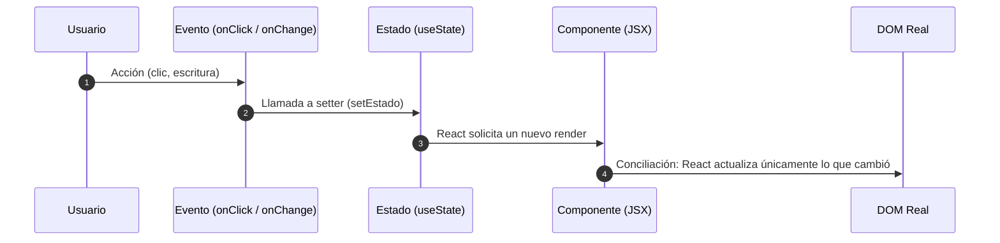

# Taller 2 · Fundamentos de React

Repositorio con el desarrollo teórico y conceptual del **Taller 2: Fundamentos de React**, correspondiente al curso de **Desarrollo de Front-end**.

---

## Información General

- **Estudiante:** Josué de Jesús Torres Torres
- **Curso:** Desarrollo de Front-end
- **Fecha de entrega:** Viernes 16 de octubre de 2026
- **Documento principal:** [`taller-2.md`](./taller-2.md)

---

## Propósito del Repositorio

Este repositorio contiene la investigación, análisis crítico, diagramas conceptuales y ejemplos de código que explican el funcionamiento interno, los elementos estructurales y la relevancia de **React** en el desarrollo web moderno y en la industria del software.

El documento exhaustivo con todas las explicaciones y citas se encuentra en [**`taller-2.md`**](./taller-2.md).

---

## Estructura del Repositorio

```text
Desarrollo_F_Taller_2/
├── README.MD          # Presentación y resumen ejecutivo del taller (este archivo)
├── taller-2.md        # Documento completo con el desarrollo de todos los puntos
├── taller_2.txt       # Copia de respaldo en formato texto plano
└── .gitattributes     # Configuración de normalización de saltos de línea (LF)
```

---

## Contenido del Taller

El taller responde de forma detallada a los 5 ejes temáticos de los fundamentos de React:

### 1. ¿Qué es React?
- **Definición y propósito:** Biblioteca de JavaScript para la capa de vista de aplicaciones web y nativas, basada en el paradigma de componentes reutilizables.
- **Origen e historia:** Creada por Jordan Walke en Facebook (Meta). Probada en producción en el News Feed (2011), Instagram (2012) y liberada como código abierto en la JSConf US el 29 de mayo de 2013.
- **Librería vs. Framework:** Por qué React se limita a la interfaz de usuario delegando enrutamiento y arquitectura a herramientas como Vite, React Router o Next.js.
- **Paradigma declarativo:** Expresar *qué* debe renderizarse según los datos en lugar de ordenar paso a paso *cómo* modificar el DOM imperativamente.

### 2. ¿Qué problema resuelve React?
- **La fragilidad del DOM manual:** Los problemas de inconsistencia y desincronización derivados de llamadas directas como `querySelector`, `textContent` y `addEventListener`.
- **Imperativo vs. Declarativo:** Comparativa entre ordenar pasos y declarar estados.
- **Reconciliación y Virtual DOM:** Cómo React mantiene la interfaz sincronizada evaluando diferencias y aplicando solo los cambios indispensables.
- **Componentes reutilizables:** Eliminación de la duplicación de marcado y lógica mediante piezas modulares con responsabilidad única.

### 3. Principales elementos de React
Explicación con sintaxis, reglas y ejemplos prácticos:
1. **Componentes:** Funciones que retornan JSX y comienzan con mayúscula.
2. **JSX:** Extensión de sintaxis para describir interfaces en JavaScript con reglas estrictas (cierre de etiquetas, fragmentos `<>`, `className`, llaves `{}`).
3. **Props:** Parámetros unidireccionales (padre $\to$ hijo) de solo lectura que parametrizan la presentación.
4. **Estado (`useState`):** Memoria local del componente que desencadena nuevos renders al actualizarse.
5. **Eventos (`onClick`, `onChange`):** Manejadores que conectan las acciones del usuario con la mutación del estado mediante funciones controladas.



### 4. Importancia de React en la industria
- **Escalabilidad y mantenibilidad:** Por qué las grandes empresas prefieren interfaces declarativas sobre parches imperativos en proyectos de miles de componentes.
- **Ecosistema:** El rol de empaquetadores modernos (Vite), frameworks de renderizado híbrido (Next.js), desarrollo multiplataforma (React Native) y librerías de pruebas (React Testing Library).
- **Gobernanza y comunidad:** La transición histórica hacia la **React Foundation** bajo el amparo de la **Linux Foundation** (anunciada en 2025 y constituida formalmente en febrero de 2026) con miembros como Meta, Microsoft, Amazon, Vercel, Expo y Callstack.
- **Relevancia profesional:** Alta demanda en el mercado laboral respaldada por encuestas como Stack Overflow 2025.

### 5. Empresas que utilizan React
Casos reales de ingeniería y arquitectura en producción:
- **Meta:** Creadores del proyecto; validación continua en plataformas con más de mil millones de usuarios activos y más de 100.000 componentes internos.
- **Netflix:** Adopción para la interfaz de televisores mediante la variante customizada *React-Gibbon*, priorizando rendimiento en dispositivos con hardware limitado.
- **Microsoft:** Base arquitectónica del portal web empresarial **Azure Portal** y patrocinador Platinum de la React Foundation.
- **Airbnb:** Referente en guías de estilo para la comunidad y migraciones masivas de suites de pruebas.

---

## Tecnologías y Conceptos Abordados

- **Lenguaje:** JavaScript (ES6+) / JSX
- **Biblioteca:** React (Componentes funcionales, Hooks)
- **Modelos:** Flujo unidireccional de datos, Programación Declarativa, Reconciliación
- **Diagramación:** Mermaid.js

---

## Consulta del Documento Completo

Para leer el desarrollo íntegro de cada punto, con las tablas comparativas, fragmentos de código comentados y las 15 referencias bibliográficas oficiales (Meta, MDN, Stack Overflow, Netflix TechBlog, Linux Foundation), abre directamente:

[**Leer `taller-2.md`**](./taller-2.md)

---

## Autor

- **Josué de Jesús Torres Torres**
- Repositorio: [Desarrollo_F_Taller_2](file:///home/lincj/Documentos/Desarrollo_F_Taller_2)
