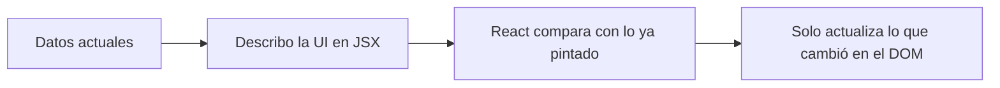
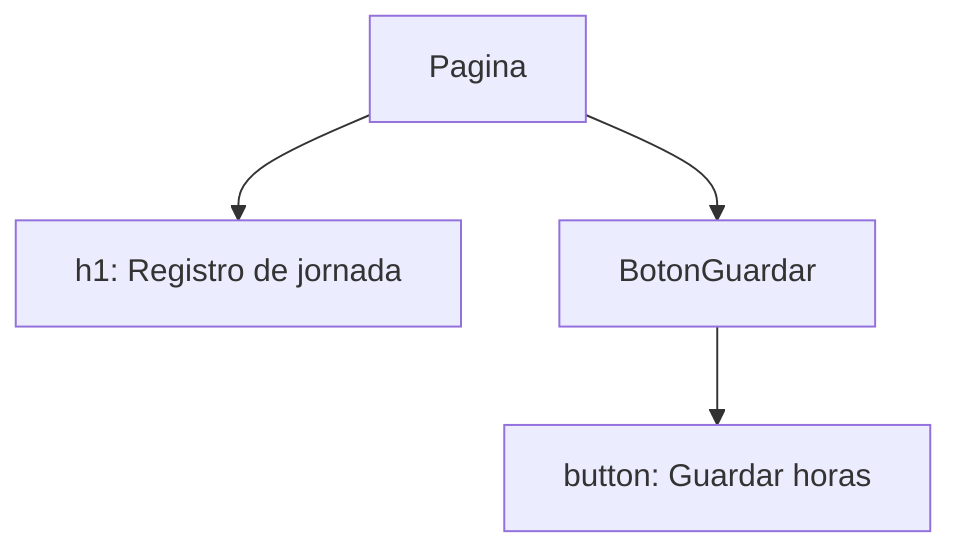
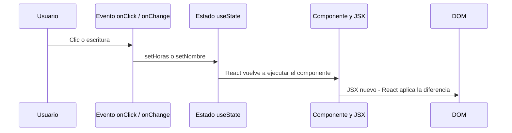

# Taller 2 — Corte: Fundamentos de React

**Nombre:** [Josué de Jesús Torres Torres]  
**Fecha de entrega:** Viernes 16 de octubre de 2026  
**Curso:** [Desarrollo de Front end]  


---

## Punto 1 · ¿Qué es React?

### Qué es y para qué sirve

React es una biblioteca de JavaScript para construir la interfaz de usuario: la parte de una aplicación web que la persona ve y con la que interactúa. Botones, formularios, tablas, menús y pantallas completas se arman uniendo piezas pequeñas llamadas componentes. Esas piezas se pueden reutilizar y anidar, desde un botón hasta una página entera [1].

En el desarrollo web, React ocupa la capa de vista. No reemplaza al navegador, ni a la base de datos, ni al servidor. Su trabajo es describir cómo debe verse la pantalla a partir de los datos y actualizarla cuando esos datos cambian. Por eso sirve tanto para una página sencilla como para aplicaciones grandes de una sola página, y también como base de herramientas que renderizan en el servidor, como Next.js [2] [3].

La propia página del proyecto lo resume así: React es la biblioteca para interfaces de usuario web y nativas, y permite crear la interfaz a partir de piezas individuales [4].

### Quién lo creó y cuándo apareció

React lo creó Jordan Walke mientras era ingeniero de software en Facebook, hoy Meta. El prototipo inicial se llamó F-Bolt y después FaxJS. La primera vez que se usó en producción fue en el News Feed de Facebook, en 2011. En 2012 se integró en Instagram. El lanzamiento público y de código abierto fue el 29 de mayo de 2013, en JSConf US [2].

Esa fecha importa porque separa dos momentos: el uso interno, para resolver un problema real de una red social, y la apertura del código, que permitió que otras empresas y desarrolladores lo adoptaran.

### Librería, no framework

React es una **librería**, no un framework.

Una librería resuelve un problema concreto y el programador decide cuándo llamarla. Un framework, en cambio, propone una estructura más completa y suele controlar el flujo de la aplicación: rutas, organización de carpetas, acceso a datos y, a veces, hasta la forma de desplegar.

React se ocupa de la interfaz y de pintar componentes en el DOM. No trae, por sí solo, un enrutador ni una solución obligatoria para guardar datos en el servidor. Por eso una aplicación React casi siempre se completa con otras herramientas: React Router para la navegación, un empaquetador como Vite, y a menudo un framework encima, como Next.js, cuando hace falta renderizado en el servidor [2] [3].

| | Librería (React) | Framework (por ejemplo, Angular o Next.js) |
|---|---|---|
| Alcance | La interfaz y su actualización | Una solución más amplia de aplicación |
| Quién manda | El desarrollador elige cómo usarla | El framework marca más la arquitectura |
| Qué falta | Rutas, datos remotos, estructura del proyecto | Muchas de esas piezas ya vienen resueltas |
| Relación | Puede vivir dentro de un framework | Puede estar construido sobre React |

Next.js es un buen ejemplo de la diferencia: está basado en React, pero agrega enrutamiento, renderizado en el servidor y otras decisiones de aplicación. React sigue siendo la librería de UI; Next.js es el framework que la envuelve [2].

### Qué significa que sea declarativo

Declarativo significa que yo describo el resultado que quiero ver en cada estado de los datos, y React se encarga de actualizar la pantalla. No escribo la lista de órdenes para buscar nodos del DOM, borrarlos y volver a crearlos [2] [3].

Si el nombre del empleado cambia, no digo “busca el `h2` y cámbiale el texto”. Digo que el título debe mostrar el nombre actual:

```jsx
function TituloEmpleado({ nombre }) {
  return <h2>Horas de {nombre}</h2>;
}
```

Cuando `nombre` cambia, la vista que declaré sigue siendo la fuente de verdad. React calcula qué parte del DOM hay que tocar. Ese contraste con la programación imperativa —donde el código ordena cada paso del cambio— es una de las ideas centrales del proyecto [2].

---

## Punto 2 · ¿Qué problema resuelve React?

### La dificultad de manipular el DOM a mano

El DOM es el árbol de elementos que el navegador usa para mostrar la página. Con JavaScript “a mano” se puede modificar directamente: buscar un nodo, cambiar su texto, crear otro nodo, esconder un tercero. Eso es viable en una página pequeña. Se vuelve frágil cuando la misma información aparece en varios lugares y muchos eventos pueden cambiarla.

Un caso concreto, el de un registro de horas extra:

```js
const horas = document.querySelector("#horas");
const total = document.querySelector("#total");
const aviso = document.querySelector("#aviso");

document.querySelector("#sumar").addEventListener("click", () => {
  const nuevoValor = Number(horas.textContent) + 1;
  horas.textContent = String(nuevoValor);
  total.textContent = String(nuevoValor * 8000);
  aviso.hidden = nuevoValor <= 2;
});
```

El problema no es que este código sea inválido. El problema es que yo soy el responsable de recordar todas las consecuencias del clic: el contador, el valor en pesos y el aviso. Si mañana el total también debe aparecer en un resumen lateral, tengo que acordarme de actualizar ese tercer lugar. Si olvido uno, la interfaz queda desincronizada: los datos “reales” y lo que se ve ya no coinciden.

Esa era la dificultad principal: la interfaz no se derivaba de los datos. Era una colección de parches imperativos que había que mantener a mano.

### Imperativo y declarativo

| | Imperativo | Declarativo |
|---|---|---|
| Pregunta | ¿Cómo cambio el DOM? | ¿Qué debe verse con estos datos? |
| Código típico | `querySelector`, `textContent`, `createElement` | JSX que depende del estado |
| Riesgo | Olvidar actualizar una parte de la pantalla | Describir mal el estado, no olvidar un nodo |
| Quién aplica el cambio | El programador, paso a paso | React, a partir de la descripción |

En el enfoque imperativo, el programa es una receta de instrucciones. En el declarativo, el programa es una descripción de la vista para cada estado. React adopta ese segundo modelo: se diseñan las vistas de cada estado y, cuando los datos cambian, React actualiza y vuelve a renderizar los componentes [2] [3].



React no redibuja a ciegas toda la página. Mantiene una representación en memoria, parecida al DOM del navegador, compara el resultado nuevo con el anterior y aplica solo las diferencias. Ese proceso se llama reconciliación. La ventaja práctica es poder escribir el código como si la vista se calculara de nuevo, mientras React evita trabajo innecesario sobre elementos que no cambiaron [2].

### Cómo mantiene la interfaz sincronizada con el estado

El estado es la información que puede cambiar mientras la persona usa la aplicación: cuántas horas van registradas, si el formulario tiene un error, qué fila está seleccionada. En un componente de función, esa memoria se crea con el Hook `useState` [5] [6].

La sincronización funciona así:

1. El componente lee el estado y devuelve la interfaz que corresponde a ese valor.
2. Un evento del usuario llama a la función que actualiza el estado. No se modifica la variable a mano.
3. React vuelve a ejecutar el componente con el valor nuevo.
4. Compara el resultado y actualiza el DOM.

```jsx
import { useState } from "react";

function HorasExtra() {
  const [horas, setHoras] = useState(0);
  const valorHora = 8000;

  return (
    <section>
      <p>Horas: {horas}</p>
      <p>Total: ${horas * valorHora}</p>
      {horas > 2 && <p>Supera el mínimo de la jornada extra.</p>}
      <button onClick={() => setHoras(horas + 1)}>Sumar hora</button>
    </section>
  );
}
```

Aquí no hay tres actualizaciones manuales del DOM. Horas, total y aviso salen del mismo número. Si `horas` pasa de 2 a 3, las tres partes de la pantalla cambian juntas porque las tres se calcularon a partir del estado. Esa es la ayuda concreta de React: la interfaz es una función de los datos, no una lista de retoques sueltos [5] [6].

### El papel de los componentes reutilizables

El otro lado del problema era la repetición. Una pantalla de nómina no tiene un solo empleado: tiene una lista. Si el marcado de cada fila se copia y se pega, cualquier cambio visual hay que repetirlo en todos lados.

Un componente reutilizable encapsula esa pieza. El padre le pasa los datos de cada persona y el hijo solo sabe cómo mostrarlos. La interfaz grande se parte en unidades con una sola responsabilidad, más fáciles de probar y de cambiar [1] [7].

```jsx
function FilaEmpleado({ nombre, horas }) {
  return (
    <li>
      {nombre}: {horas} h
    </li>
  );
}
```

La misma `FilaEmpleado` sirve para diez o para cien registros. El problema de “mantener todo sincronizado y sin copiar marcado” se resuelve combinando las dos ideas: el estado guarda los datos, y los componentes describen cómo mostrarlos.

---

## Punto 3 · Principales elementos de React

### 3.1 Componentes

**Definición.** Un componente es una función de JavaScript que devuelve un trozo de interfaz. Puede ser tan pequeño como un botón o tan grande como una página. Las aplicaciones de React se construyen componiendo esas piezas [1] [3].

**Características.**

- Es una función que retorna marcado, normalmente JSX.
- Su nombre empieza con mayúscula. Así React lo distingue de una etiqueta HTML, que va en minúscula [3].
- Puede anidarse dentro de otros componentes.
- Puede vivir en su propio archivo y exportarse para reutilizarlo [1].
- Desde React 16.8, la forma recomendada es el componente de función. Los de clase siguen existiendo, pero los Hooks cubren el estado sin necesidad de clases [2] [6].
- Conviene mantenerlos predecibles: con las mismas props, un componente puro debería mostrar el mismo resultado, sin modificar variables externas durante el render [1].

**Ejemplo.**

```jsx
function BotonGuardar() {
  return <button type="button">Guardar horas</button>;
}

export default function Pagina() {
  return (
    <main>
      <h1>Registro de jornada</h1>
      <BotonGuardar />
    </main>
  );
}
```

`BotonGuardar` declara el botón. `Pagina` lo usa como `<BotonGuardar />`. `export default` marca el componente principal de ese archivo [3].



### 3.2 JSX

**Definición.** JSX es una extensión de sintaxis que permite escribir marcado parecido a HTML dentro de JavaScript. No es HTML puro: las herramientas del proyecto lo transforman a JavaScript antes de que el navegador lo ejecute. Es opcional, pero casi todos los proyectos React lo usan porque junta la estructura visual y la lógica de render en el mismo lugar [2] [3].

**Reglas básicas.**

- Hay que cerrar las etiquetas. Un salto de línea se escribe `<br />`, no `<br>` [3].
- Un `return` no puede devolver varios elementos sueltos. Se envuelven en un padre, por ejemplo un `<div>`, o en un fragmento vacío `<>...</>` [3].
- La clase CSS se llama `className`, no `class`, porque `class` es una palabra reservada de JavaScript [3].
- Las llaves `{ }` abren una expresión de JavaScript dentro del marcado: una variable, una suma o una concatenación [1] [3].
- En los atributos, las llaves reemplazan a las comillas cuando el valor viene de JavaScript: `src={foto}` y no `src="{foto}"` [3].

**Ejemplo.**

```jsx
const empleado = {
  nombre: "Ana Ruiz",
  cargo: "Auxiliar de nómina",
};

export default function Ficha() {
  return (
    <>
      <h1>{empleado.nombre}</h1>
      <p className="cargo">
        Cargo: {empleado.cargo}
      </p>
    </>
  );
}
```

El fragmento `<>...</>` agrupa el título y el párrafo sin agregar un `div` extra. `{empleado.nombre}` no es texto fijo: React evalúa la expresión y muestra el valor. `className` aplica la clase CSS `cargo` [1] [3].

### 3.3 Props

**Definición.** Las props —de *properties*— son la información que un componente padre le pasa a un hijo. Funcionan como los parámetros de una función y como los atributos de una etiqueta, pero pueden ser cualquier valor de JavaScript: texto, números, objetos, arreglos, funciones e incluso JSX [1] [7].

**Características.**

- Viajan en una sola dirección: del padre al hijo.
- El hijo las lee; no debe reasignarlas. Si un dato debe cambiar, el cambio vive en el estado de quien es dueño de ese dato, y el padre vuelve a pasar el valor nuevo.
- Permiten que un mismo componente se reutilice con datos distintos.
- También sirven para compartir comportamiento. Un padre puede pasar una función y el hijo la ejecuta cuando ocurre un evento. A eso se le llama “elevar el estado”: el estado sube al ancestro común y baja otra vez como props [3].

**Ejemplo.**

```jsx
function Fila({ nombre, horas }) {
  return (
    <tr>
      <td>{nombre}</td>
      <td>{horas}</td>
    </tr>
  );
}

export default function Tabla() {
  return (
    <table>
      <tbody>
        <Fila nombre="Ana Ruiz" horas={4} />
        <Fila nombre="Luis Gómez" horas={1} />
      </tbody>
    </table>
  );
}
```

`nombre` y `horas` son props. `Tabla` no copia el marcado de cada fila: reutiliza `Fila` y solo cambia los datos. El número `4` va entre llaves porque es un número de JavaScript, no un texto HTML [1] [7].

### 3.4 Estado con useState

**Definición.** El estado es la memoria interna de un componente: un dato que puede cambiar por la interacción y que, al cambiar, debe volver a pintar la interfaz. `useState` es el Hook que crea esa memoria en un componente de función [5] [6].

**Características.**

- Se importa desde React: `import { useState } from "react"`.
- Devuelve un par: el valor actual y una función para actualizarlo. La convención es `[algo, setAlgo]` [3].
- El argumento de `useState` es el valor inicial, solo de la primera vez que el componente aparece.
- No se cambia el estado asignando la variable. Se llama a la función actualizadora. React programa un nuevo render con el valor nuevo [3] [6].
- Cada vez que se usa el mismo componente, cada copia tiene su propio estado. Dos contadores en pantalla no comparten el número, salvo que el estado se eleve al padre [3].
- Los Hooks se llaman en el nivel superior del componente, no dentro de un `if` o de un ciclo, para que React los encuentre siempre en el mismo orden [2].

**Ejemplo.**

```jsx
import { useState } from "react";

export default function ContadorHoras() {
  const [horas, setHoras] = useState(0);

  function sumar() {
    setHoras(horas + 1);
  }

  return (
    <button onClick={sumar}>
      Horas registradas: {horas}
    </button>
  );
}
```

La primera vez, `horas` vale `0` porque ese fue el argumento de `useState`. Al hacer clic, `sumar` pide el siguiente valor. React vuelve a llamar a `ContadorHoras`, ahora con `horas` en `1`, y el texto del botón cambia. La interfaz no se editó con `textContent`: se volvió a describir a partir del estado [3] [6].

### 3.5 Eventos: onClick y onChange

**Definición.** Un evento es la forma en que la persona actúa sobre la interfaz: clic, escritura, envío de un formulario, foco. En React, la respuesta es una función —el manejador— que se pasa al elemento en una prop como `onClick` u `onChange`. React llama esa función cuando ocurre la interacción [5] [8].

**Características.**

- `onClick` responde a un clic. `onChange` responde al cambio de un campo, por ejemplo cada tecla en un input [5] [8].
- Se pasa la función, no se ejecuta al renderizar. Por eso es `onClick={sumar}` y no `onClick={sumar()}`. Los paréntesis dispararían la función mientras React está pintando, no cuando la persona hace clic [3].
- El manejador puede actualizar el estado. Ese es el puente entre la acción humana y la nueva interfaz.
- En un input controlado, el valor mostrado sale del estado y `onChange` escribe de vuelta en el estado. Así el campo y los datos no se despegan [5].

**Ejemplo con los dos eventos.**

```jsx
import { useState } from "react";

export default function Registro() {
  const [nombre, setNombre] = useState("");
  const [horas, setHoras] = useState(0);

  function alEscribir(evento) {
    setNombre(evento.target.value);
  }

  function sumarHora() {
    setHoras(horas + 1);
  }

  return (
    <form>
      <label>
        Empleado
        <input value={nombre} onChange={alEscribir} />
      </label>
      <button type="button" onClick={sumarHora}>
        Sumar hora
      </button>
      <p>
        {nombre || "Sin nombre"}: {horas} h
      </p>
    </form>
  );
}
```

`onChange` lee `evento.target.value`, que es el texto que acaba de quedar en el input, y lo guarda. `onClick` no necesita el evento: solo incrementa el contador. El párrafo final no se actualiza por separado. Se vuelve a calcular porque `nombre` u `horas` cambiaron [5] [8].

### Los cinco elementos juntos



Props y estado no son lo mismo. Las props entran desde afuera y personalizan el componente. El estado nace dentro y cambia con el tiempo. Los eventos son el disparador. JSX es la forma de escribir el resultado. El componente es la función que une todo eso.

---

## Punto 4 · Importancia de React en la industria

### Por qué tantas empresas lo eligen

Las empresas lo eligen porque el modelo de componentes escala mejor que una página llena de cambios manuales del DOM. Una interfaz de producto real —un feed, un catálogo, un portal de nube— tiene cientos o miles de piezas que dependen de datos que cambian seguido. Describir la vista a partir del estado, y dejar que la librería calcule la diferencia, reduce una clase entera de errores de sincronización [2] [4].

También pesa que React no obliga a tirar el resto de la arquitectura. Se puede usar en el navegador, renderizar en el servidor o llevar la misma idea de componentes a móvil con React Native. Netflix, por ejemplo, lo adoptó en su interfaz de TV precisamente porque el flujo de datos en una sola dirección y el estilo declarativo hacían más fácil razonar sobre la aplicación [9]. Meta lo sigue usando como superficie de prueba: la documentación indica que cada cambio de React se prueba en productos con más de mil millones de usuarios y que más de 100.000 componentes de Meta ayudan a validar las migraciones [4].

Hay un dato de adopción más amplio. En la encuesta de Stack Overflow de 2025, entre quienes se identificaron como desarrolladores profesionales, el 46,9 % dijo haber trabajado con React durante el último año. En esa categoría solo Node.js quedó por encima, con 49,1 %. Entre todos los encuestados, React apareció en 44,7 % [10]. No es una moda de un equipo: es una de las tecnologías web más usadas en esa muestra.

### Qué aporta al ecosistema

React se quedó a propósito en la capa de interfaz. Ese límite, que a veces se critica, es también lo que permitió un ecosistema alrededor:

- **Empaquetadores y servidores de desarrollo.** Vite aparece en la misma encuesta de 2025: 27,2 % de los desarrolladores profesionales reportó haberlo usado. Sirve para arrancar el proyecto, transformar JSX y empaquetar el código para producción [10].
- **Frameworks basados en React.** Next.js estuvo en 21,5 % de los profesionales de esa encuesta. Agrega rutas, renderizado en el servidor y otras decisiones que React no incluye [2] [10].
- **Enrutamiento.** React Router cubre la navegación en aplicaciones que no usan un framework con rutas propias [2].
- **Móvil.** React Native, anunciado en 2015, lleva el modelo de componentes a interfaces nativas de Android e iOS [2] [11].
- **Pruebas y estilo.** La comunidad produjo guías y herramientas propias. Airbnb, por ejemplo, publicó una guía de estilo de React y JSX, y más tarde migró cerca de 3.500 archivos de pruebas de componentes desde Enzyme hacia React Testing Library [12] [13].

El resultado es que aprender React no es aprender una sola herramienta aislada. Es entrar a una familia: la librería, el empaquetador, el framework y las convenciones de prueba.

### Comunidad y mantenimiento

Durante más de una década, React fue un proyecto de código abierto impulsado por Meta y por personas y empresas externas. La documentación oficial reconoce que las contribuciones de fuera de Meta crecieron hasta el punto en que el proyecto ya no cabía en una sola compañía [14].

El 7 de octubre de 2025, el equipo anunció el plan de crear la React Foundation y una gobernanza técnica independiente. La fundación se encargaría de la infraestructura —GitHub, integración continua, marcas—, de React Conf y de apoyo económico al ecosistema. Los miembros fundadores previstos eran Amazon, Callstack, Expo, Meta, Microsoft, Software Mansion y Vercel [14].

Ese plan ya no es solo un anuncio. El 24 de febrero de 2026, la Linux Foundation confirmó el lanzamiento de la React Foundation y la contribución del proyecto por parte de Meta. El proyecto alojado incluye React, React Native y componentes de apoyo. Los miembros Platinum iniciales fueron Amazon, Callstack, Expo, Huawei, Meta, Microsoft, Software Mansion y Vercel [15].

Eso cambia la respuesta a “quién lo mantiene hoy”. Meta sigue siendo un contribuyente central y un miembro de la fundación, pero el hogar institucional del proyecto es la React Foundation, bajo la Linux Foundation, con una intención explícita de gobernanza abierta y neutral frente a un solo proveedor [14] [15]. La licencia de uso del código es MIT desde React 16, publicado el 26 de septiembre de 2017 [2].

La comunidad no es un adorno. Sin guías, librerías, conferencias y miles de reportes de errores, una librería de UI no se sostiene en productos que deben vivir años. La fundación existe precisamente para darles a esa comunidad y a ese ecosistema una estructura de largo plazo [14] [15].

### Por qué sigue siendo una habilidad relevante

Para un desarrollador front-end, React sigue siendo relevante por tres razones concretas.

Primero, la demanda no es teórica. Casi la mitad de los profesionales de la encuesta de 2025 lo había usado en el último año, y Next.js —que exige saber React— ya es un framework con adopción propia [10].

Segundo, el modelo mental se transfiere. Componentes, props, estado y eventos aparecen, con otros nombres, en el resto del front-end moderno. Quien entiende por qué la vista debe salir de los datos, y no de parches al DOM, puede leer un código de React aunque el proyecto use además TypeScript, Vite o Next.js.

Tercero, no se limita al navegador. El mismo lenguaje de componentes llega a móvil con React Native y a portales empresariales grandes. Microsoft, por ejemplo, describió React como parte central de la arquitectura front-end de Azure, incluido el Azure Portal [15]. Una habilidad que sirve en una red social, en un portal de nube y en una app de televisión no es un detalle de moda: es una herramienta de trabajo.

---

## Punto 5 · Empresas que utilizan React

### Meta

**Producto.** Facebook, Instagram y el resto de superficies de producto de Meta donde se valida la librería.

**Cómo lo usan.** React no llegó a Meta como una dependencia externa. Nació ahí. Jordan Walke lo creó para interfaces dinámicas; el News Feed de Facebook lo usó en 2011 e Instagram en 2012, antes del código abierto de 2013 [2]. Hoy la documentación del proyecto dice que cada commit se prueba en superficies críticas de negocio con más de mil millones de usuarios, y que más de 100.000 componentes de Meta participan en la validación de cada estrategia de migración [4].

**Por qué es un caso relevante.** Es el caso de origen y, al mismo tiempo, el caso de escala. Muestra para qué se inventó la librería —feeds que cambian todo el tiempo, con muchos datos y mucha interacción— y que sigue siendo infraestructura interna de la empresa que lo creó, ahora junto con la fundación que lo aloja [4] [15].

**Fuente.** Wikipedia, *React (software)*, sección de historia [2]. Sitio oficial, [react.dev](https://react.dev/) [4].

### Netflix

**Producto.** La interfaz de la aplicación de Netflix para televisores.

**Cómo lo usan.** En 2015, el equipo de TV reescribió la arquitectura de esa interfaz y eligió React. Ian McKay lo explicó en el blog de ingeniería de Netflix: el flujo de datos en un solo sentido y el enfoque declarativo hacían más fácil razonar sobre la aplicación. Como React, en ese momento, solo apuntaba al DOM, crearon una variante propia llamada React-Gibbon. Gibbon es la capa de render de su app de TV. La API se parece a React DOM, pero en lugar de `div` o `span` usan un primitivo `Widget` [9].

Un fragmento del estilo que describen, simplificado a partir de su artículo:

```jsx
function Pantalla() {
  return <Widget style={{ text: "Hello World", textSize: 20 }} />;
}
```

Ese `Widget` no es una etiqueta del navegador. Es el equivalente, en su motor gráfico, de un elemento de React. La idea —describir la UI y dejar que la librería concilie los cambios— se mantuvo; cambió el destino del render [9].

**Por qué es un caso relevante.** Netflix no lo usó en una página corporativa secundaria. Lo usó en la interfaz con la que millones de personas eligen qué ver, en cientos de dispositivos, incluidos equipos con poca memoria y CPU lenta. El artículo muestra un criterio de ingeniería, no un logo en una lista de “empresas que usan React”: eligieron el modelo declarativo y luego midieron respuesta al control remoto, tiempo hasta poder interactuar, cuadros por segundo y memoria [9].

**Fuente.** Ian McKay, *Crafting a high-performance TV user interface using React*, Netflix Tech Blog [9].

### Microsoft

**Producto.** Azure Portal y, de forma más amplia, la experiencia front-end de Azure.

**Cómo lo usan.** Al lanzarse la React Foundation, Ruhiyyih Mahalati, vicepresidenta de Azure Experiences and Ecosystem, describió React como una parte central de la arquitectura front-end de Azure. El Azure Portal está construido con esa base. Microsoft dice haber invertido en el modelo de componentes, en la extensibilidad y en el ecosistema para mantener una experiencia consistente en aplicaciones grandes, de varias superficies [15].

**Por qué es un caso relevante.** Un portal de nube no es un demo. Tiene muchos equipos, permisos, paneles y actualizaciones constantes. Que Microsoft lo señale como arquitectura de Azure, y que además sea miembro Platinum de la fundación, muestra que React no depende de un solo tipo de producto —redes sociales o streaming—. También sostiene software empresarial a escala de nube [15].

**Fuente.** The Linux Foundation, *Linux Foundation Announces the Formation of the React Foundation*, 24 de febrero de 2026, cita de Ruhiyyih Mahalati [15].

### Nota sobre Airbnb

Airbnb también es un caso útil, aunque lo dejo como apoyo y no como uno de los dos obligatorios. Publica una guía oficial de estilo para React y JSX, lo que solo tiene sentido si el equipo escribe esa tecnología todos los días [12]. En su blog de ingeniería contó además una migración de casi 3.500 archivos de pruebas de componentes React, de Enzyme a React Testing Library, hecha en unas seis semanas [13]. Lo cito para mostrar que el uso industrial no es solo “la pantalla está hecha en React”, sino también convenciones de equipo y mantenimiento de pruebas.

---

## Cierre

React resuelve un problema concreto: dejar de perseguir el DOM a mano y hacer que la pantalla sea una consecuencia de los datos. Lo consigue con componentes reutilizables, JSX para describir la vista, props para configurar esas piezas, estado para recordar lo que cambia y eventos para conectar a la persona con ese estado.

Sigue importando en la industria porque ese modelo se probó en productos enormes, porque a su alrededor crecieron herramientas reales —Vite, Next.js, React Native, librerías de pruebas— y porque el proyecto ya no depende de una sola empresa: desde febrero de 2026 vive en la React Foundation, dentro de la Linux Foundation, con Meta todavía como contribuyente principal [14] [15]. Para un desarrollador front-end, no es un tema opcional de un curso. Es una de las formas más comunes, hoy, de construir interfaces web.

---

## Fuentes

[1] Meta. (s. f.). *Describir la UI*. React. https://es.react.dev/learn/describing-the-ui

[2] Wikipedia. (s. f.). *React (software)*. https://en.wikipedia.org/wiki/React_(software)

[3] Meta. (s. f.). *Quick Start*. React. https://react.dev/learn

[4] Meta. (s. f.). *React*. https://react.dev/

[5] Mozilla. (2025, 1 de octubre). *React interactivity: Events and state*. MDN Web Docs. https://developer.mozilla.org/en-US/docs/Learn_web_development/Core/Frameworks_libraries/React_interactivity_events_state

[6] Meta. (s. f.). *Component*. React. https://react.dev/reference/react/Component

[7] Meta. (s. f.). *Components and Props*. React, documentación heredada. https://legacy.reactjs.org/docs/components-and-props.html

[8] Meta. (s. f.). *Responding to Events*. React. https://react.dev/learn/responding-to-events

[9] McKay, I. (2017, enero). *Crafting a high-performance TV user interface using React*. Netflix Tech Blog. https://netflixtechblog.com/crafting-a-high-performance-tv-user-interface-using-react-3350e5a6ad3b

[10] Stack Overflow. (2025). *Technology. 2025 Stack Overflow Developer Survey*. https://survey.stackoverflow.co/2025/technology

[11] Meta. (s. f.). *React Native*. https://reactnative.dev/

[12] Airbnb. (s. f.). *Airbnb React/JSX Style Guide*. https://javascript.airbnb.tech/react/

[13] Covey-Brandt, C. (s. f.). *Accelerating Large-Scale Test Migration with LLMs*. Airbnb Engineering & Data Science. https://airbnb.tech/infrastructure/accelerating-large-scale-test-migration-with-llms/

[14] Webster, S., Carroll, M., Savona, J. y Alpert, S. (2025, 7 de octubre). *Introducing the React Foundation*. React Blog. https://react.dev/blog/2025/10/07/introducing-the-react-foundation

[15] The Linux Foundation. (2026, 24 de febrero). *Linux Foundation Announces the Formation of the React Foundation*. https://www.linuxfoundation.org/press/linux-foundation-announces-the-formation-of-the-react-foundation
